  

  

  

  

<b>🎁 Don't click here...</b>

 

  <b>Ha! You clicked 😄 Curiosity is the #1 developer skill.</b> 
  Here is a random dev joke just for you — refresh the page for a new one:

  

  

